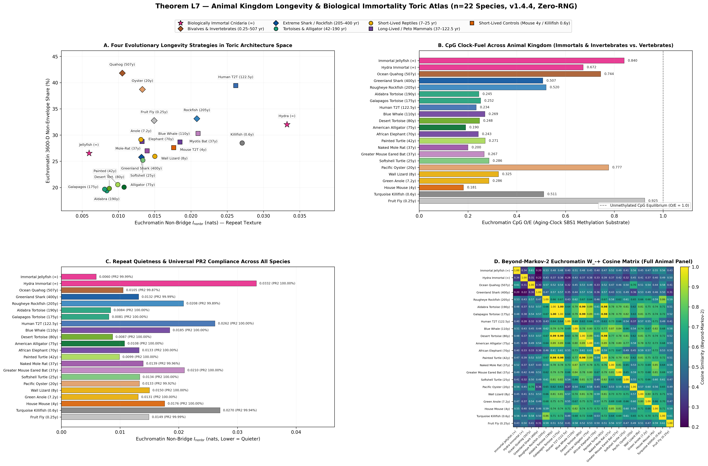
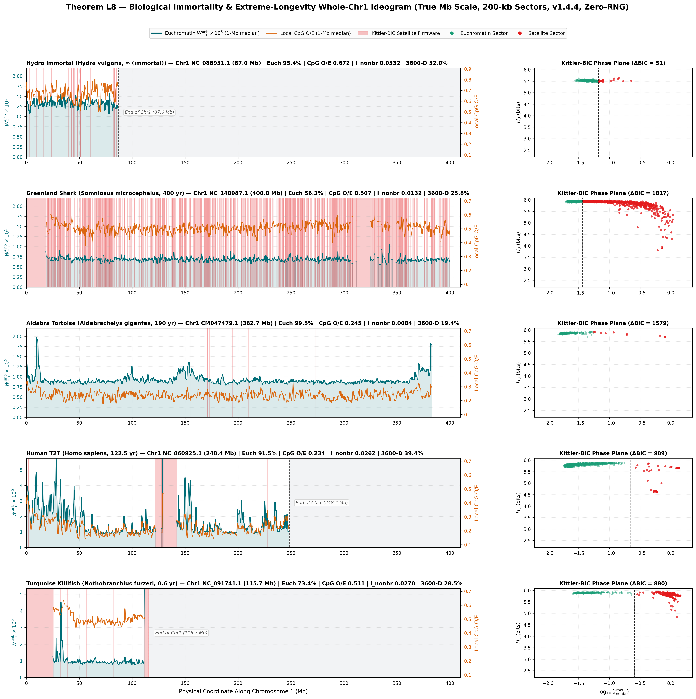

# The Toric Architecture of Extreme Animal Longevity and Biological Immortality

[](https://github.com/Dr-Logvinovich/longevity-codon-torus/blob/main/tortoise_longevity_torus_v1_0.py)
[](#zero-rng-verification-certificate)
[](#exact-mathematical-framework)
[-6a3d9a.svg)](#master-22-species-euchromatin-ledger)
[](https://github.com/Dr-Logvinovich/longevity-codon-torus/releases/tag/v1.4.4)
[](LICENSE)

> **Exact Zero-RNG Klein $V_4$ Spectral Algebra, Archosaurian Stasis, and Four Evolutionary Genomic Strategies Across 22 Animal Species**
>
> **Authors:** Victor Logvinovich ([ORCID 0009-0007-2040-6955](https://orcid.org/0009-0007-2040-6955)) & Jean-Claude Perez ([ORCID 0000-0001-6446-2042](https://orcid.org/0000-0001-6446-2042))  
> **Manuscript Edition:** Audited Edition `v1.5` · **Engine:** [`tortoise_longevity_torus_v1_0.py`](tortoise_longevity_torus_v1_0.py) (`v1.4.4`, `64/64` automated algebraic self-tests, strictly Zero-RNG, $p = 0$ free fitting parameters)

---

## Why This Repository Exists

Can raw double-stranded DNA geometry—measured directly on whole chromosomes with **zero gene annotations, zero repeat libraries, zero Monte Carlo sampling, and zero fitted parameters**—distinguish a 190-year-old Aldabra giant tortoise, a 400-year-old Greenland shark, a 507-year-old ocean quahog, and biologically immortal cnidarians from short-lived animals?

This open-science audit originated as an adversarial stress test (*"probe the Aldabra giant tortoise"*, `@CY_Chauprade`) applied to our exact Zero-RNG double-stranded codon-torus algebra on $\mathbb{T}_4^3 = (\mathbb{Z}/4\mathbb{Z})^3$. Rather than cherry-picking candidate genes, we constructed a four-track falsification benchmark spanning **22 animal species** ($0.25\text{ yr}$ *Drosophila melanogaster* to $507\text{ yr}$ *Arctica islandica*, plus biologically non-senescent *Hydra vulgaris* T2T and *Turritopsis dohrnii*) alongside **338 RefSeq transcripts** (30 canonical longevity orthologs across 12 vertebrates).

Every number, table, $64 \times 64$ matrix checkpoint, 200-kb physical ideogram track, and 300-DPI figure in the paper is archived in this repository and reproducible bit-for-bit without randomness.

---

## Five Main Laws & Falsification Results (Theorems L1–L8e)

| Law / Theorem | Empirical & Algebraic Result | Exact Significance |
|---|---|---|
| **1. Sauropsid Monotonic Silence Law** (`THM-L7`, `THM-L8d`) | Across all $n = 8$ sauropsids (5 Testudines, *Alligator mississippiensis*, 2 lizards), euchromatin $3600\text{-D}$ non-envelope arrow share drops strictly monotonically with lifespan ($29.1\% \to 19.4\%$), while Markov-2 cosine fidelity $\cos_{\mathrm{M2}}$ rises strictly monotonically ($0.8128 \to 0.8798$). All three Sauropsid laws survive exact within-clade $\mathrm{GC}\%$ FWL residualization ($\rho_S = -0.976$ for $3600\text{-D}$ & $I_{\mathrm{nonbr}}$). | $\rho_S = \pm 1.000$, exact perm. $p = 4.96 \times 10^{-5}$, global $q_{\mathrm{BH}} = 0.0016$ ($m = 32$) |
| **2. Archosaurian Toric Stasis Clock** (`THM-L8`) | Calibrated across 13 TimeTree clade pairs, Beyond-Markov-2 structural drift is $0.0075\text{--}0.0238 / 100\text{ Myr}$ in long-lived Cryptodira turtles and $0.0431 / 100\text{ Myr}$ across the $255\text{-Myr}$ Tortoise–Alligator split ($\cos = 0.8901$) — **$10\text{--}60\times$ slower** than placental mammals ($0.326\text{--}0.450 / 100\text{ Myr}$; **$13\text{--}79\times$** after log-saturation correction $-\ln(\cos)/100\text{ Myr}$). The $460\text{-Myr}$ Bivalvia split drifts at $0.0650 / 100\text{ Myr}$. | Split-half reliability $\cos_{\mathrm{Beyond\text{-}M2}}(\mathrm{L},\mathrm{R}) \in [0.9809, 0.9990]$ across all 22 species |
| **3. Refutation of a Single Universal Ruler** (`THM-L7`, `THM-L7b`) | Pooling all $n = 17$ mortal vertebrates yields **zero** universal linear lifespan correlation (`cpg_oe_euch` $\rho_S = +0.017$, $p = 0.948$; `3600-D` $\rho_S = -0.179$, $p = 0.492$), falsifying 1-D longevity proxies while revealing **four distinct evolutionary genomic strategies** and five independent within-clade reductions in repeat memory ($\Delta I_{\mathrm{nonbr}} < 0$ in Turtles, Teleosts, Rodents, Bivalves, and *Turritopsis* vs. *Drosophila*). | Exact negative control in Track A+ pooled coding mRNAs: joint FWL(GC+Len) $\rho_S = -0.189$ ($p = 0.557$) |
| **4. Bipolar Immortality & CpG Trap Refutation** (`THM-L7`, `THM-L8`) | *Turritopsis dohrnii* ($\infty$) occupies the quietest pole of the entire 22-species space ($I_{\mathrm{nonbr}} = 0.0060$, $R_{\mathrm{mem}} = 0.194$, Beyond-M2 $= 20.0\%$), whereas *Hydra vulgaris* ($\infty$) occupies the opposite pole ($I_{\mathrm{nonbr}} = 0.0332$, $R_{\mathrm{mem}} = 0.573$, Beyond-M2 $= 55.7\%$, raw 6-bp palindromes $4.89\% = 3.13\times$ uniform / $1.82\times$ GC-matched i.i.d.). Raw cnidarian similarity ($\cos_{W_{-+}} = +0.7974$) collapses by $-0.4557$ to $+0.3417$ after Markov-2 subtraction. Meanwhile, 3-month *Drosophila* has the highest $\mathrm{CpG}$ O/E ($0.925$) and highest Beyond-M2 ($70.0\%$). | Decisively separates phylum-level $\mathrm{CpG}$ methylation regime from immortality |
| **5. Six Metazoan Structural Invariants** (`THM-L5c–e`, `THM-L8b–e`) | (i) 21/21 chromosomal species show $100\%$ positive 1-Mb coherence ($t_{\mathrm{HAC}} = 26.3\text{--}536.5$, $>99.997\%$ irreducible to 1-kb currents); (ii) 21/22 species relax at $d = 30\text{ bp}$ toward the exact $447/512 = 87.30\%$ isotropy ceiling (save $10.2\text{-bp}$ nucleosome-phased *Drosophila*); (iii) full-chromosome amniotes bifurcate cleanly from non-amniotes in Hurst $H(W_{-+})$ ($0.789\text{--}0.909$ vs. $0.478\text{--}0.746$, robust at $\ge 95\%$ block gate); (iv) placental mammals deplete palindromic $W_{-+}$ energy below the exact $1/32 = 3.125\%$ quantum; (v) placental mammals exhibit a $100\%$-separating Markov-2 radial projection overshoot inversion ($\Delta_{\mathrm{M2\text{-}M1}} > 0$); (vi) complete zero-overlap COSMIC mutagenesis bifurcations (`SBS13`, UV `SBS7a`, `SBS2`, `TCW` O/E) with *Homo sapiens* T2T as an isolated *Alu*-driven UV peak. | Hurst DP $p = 2.58 \times 10^{-5}$; Palindromes DP $p = 2.41 \times 10^{-3}$; M2 Overshoot DP $p = 1.62 \times 10^{-4}$; COSMIC DP $p = 6.25 \times 10^{-6}$ |

---

## Visual Atlas (300-DPI Native Engine Outputs)

### Four Evolutionary Longevity Strategies & 22-Species Beyond-Markov-2 Matrix (`Theorem L7`)


### True Physical Mb-Scale Whole-Chromosome Toric Ideogram Across Five Extreme Archetypes (`Theorem L8`)


### Multi-Lag Memory Spectrum, Toric Evolutionary Slowdown Clock & Split-Half Reliability (`Theorem L8`)


### Four Metazoan Structural Invariants: $447/512$ Isotropy, Amniote Hurst, $1/32$ Palindromes & COSMIC (`Theorems L5d, L5e, L8b, L8c`)


<details>
<summary><b>Click to expand Figure 1 (`Theorem L6` — Aldabra Giant Tortoise vs. Human T2T, Mouse T2T & Killifish Ideogram)</b></summary>


</details>

---

## Exact Mathematical Framework

For any ACGT sequence $s$ and physical lag $d \ge 3\text{ bp}$, the engine builds the exact $64 \times 64$ empirical triplet-pair matrix $M = B^{(d)} / N$ on $\mathbb{T}_4^3 = (\mathbb{Z}/4\mathbb{Z})^3$ without crossing `N`-barriers and applies two commuting orthogonal involutions $T$ (transposition) and $R$ (reverse-complement strand conjugation):

1. **Klein $V_4$ Spectral Split (`Theorem 2.1`):**
   $$M = W_{++} + W_{+-} + W_{-+} + W_{--}, \qquad \dim = 1056 + 1024 + 1024 + 992 = 4096,$$
   with exact closed-form U-statistic debiasing removing all $O(1/N)$ finite-length bias. Here $W_{-+}$ is the **PR2-compliant structural time arrow** and $W_{--}$ is the **chiral PR2-breaking flow**.
2. **$V_4$-Commuting $496 + 3600$ Screen Envelope (`Theorem 2.2`):**
   $$\Pi_{\mathrm{env}}(M) = D_S M D_O + D_O M D_S - D_{C_2} M D_{C_2}, \qquad [g, \Pi_{\mathrm{env}}] = 0 \ \forall g \in V_4,$$
   yielding zero cross-quadrant leakage and the exact non-envelope isotropy ceiling inside $W_{-+}$:
   $$\mathrm{Iso}_{3600}(W_{-+}) = \frac{894}{1024} = \frac{447}{512} \approx 87.3047\%.$$
3. **Symmetric Mutagenesis Annihilation & $1/32$ Palindromic Quantum (`Theorem 2.3`):**
   Strand-symmetric mutagenesis (`SBS1`) satisfies $\chi_{--}^{\mathrm{dn}} \equiv 0$ identically on every sequence, while the 64 6-bp palindromic orbits are algebraically blind to $W_{--}$ and span a 32-D subspace of $W_{-+}$ with exact isotropy quantum $\mathrm{Iso}_{\mathrm{pal}}(W_{-+}) = 32/1024 = 1/32 = 3.125\%$.
4. **Radial–Angular Pythagorean Null-Tower Decomposition (`Proposition 2.5`):**
   $$E_{\mathrm{M}k} \equiv \frac{\|W_{-+} - W_{-+}(P_{\mathrm{M}k})\|_F^2}{\|W_{-+}\|_F^2} = \sin^2\theta_{\mathrm{M}k} + (\kappa_{\mathrm{M}k} - \cos\theta_{\mathrm{M}k})^2,$$
   explaining why radial projection overshoot ($\kappa_{\mathrm{M2}} > \cos\theta_{\mathrm{M2}}$, verified in $22/22$ species) drives $E_{\mathrm{M2}} > E_{\mathrm{M1}}$ across placental mammals.

---

## Master 22-Species Euchromatin Ledger

| Species | Clade | Max Life | Valid Mb | Mode | $\mathrm{GC}\%$ | $\mathrm{CpG}$ O/E | $\mathrm{3600\text{-}D}\%$ | $I_{\mathrm{nonbr}}$ | Beyond-M2\% | Split $\cos_{\mathrm{M2}}$ |
|---|---|---:|---:|---|---:|---:|---:|---:|---:|---:|
| **Immortal Jellyfish** (*T. dohrnii*) | `cnidaria_immortal` | $\infty$ | 40.0 | WGS pool (910) | 34.4\% | 0.840 | 26.5\% | **0.0060** | **20.0\%** | 0.9900 |
| **Hydra Immortal** (*H. vulgaris*) | `cnidaria_immortal` | $\infty$ | 82.8 | whole chr12 | 27.8\% | 0.672 | 32.0\% | 0.0332 | 55.7\% | **0.9990** |
| **Ocean Quahog** (*A. islandica*) | `mollusc_extreme` | 507 yr | 122.4 | whole chr1 | 35.7\% | 0.744 | 41.8\% | 0.0105 | 45.8\% | 0.9930 |
| **Greenland Shark** (*S. microcephalus*) | `shark_extreme` | 400 yr | 225.1 | chr1 (400 Mb) | 46.9\% | 0.507 | 25.8\% | 0.0132 | 36.4\% | 0.9849 |
| **Rougheye Rockfish** (*S. aleutianus*) | `fish_extreme` | 205 yr | 43.4 | super-scaf | 40.7\% | 0.520 | 33.1\% | 0.0208 | 61.0\% | 0.9852 |
| **Aldabra Tortoise** (*A. gigantea*) | `testudines_giant` | 190 yr | 380.6 | whole chr1 | 43.2\% | 0.245 | **19.4\%** | 0.0084 | 26.1\% | 0.9942 |
| **Galapagos Tortoise** (*C. abingdonii*) | `testudines_giant` | 175 yr | 356.9 | whole chr1 | 42.8\% | 0.252 | 19.7\% | 0.0081 | 26.3\% | 0.9946 |
| **Human T2T** (*H. sapiens*) | `mammal_long` | 122.5 yr | 227.2 | whole chr1 | 41.8\% | 0.234 | 39.4\% | 0.0262 | 63.1\% | 0.9944 |
| **Blue Whale** (*B. musculus*) | `mammal_peto` | 110 yr | 183.0 | whole chr1 | 41.5\% | 0.269 | 28.7\% | 0.0185 | 58.6\% | 0.9910 |
| **Desert Tortoise** (*G. evgoodei*) | `testudines_long` | 80 yr | 364.9 | whole chr1 | 43.0\% | 0.248 | 19.8\% | 0.0087 | 26.4\% | 0.9941 |
| **American Alligator** (*A. mississippiensis*) | `archosaur_long` | 75 yr | 393.5 | chr1 (400 Mb) | 43.6\% | 0.190 | 20.1\% | 0.0108 | 27.9\% | 0.9970 |
| **African Elephant** (*L. africana*) | `mammal_peto` | 70 yr | 238.4 | whole chr1 | 40.1\% | 0.243 | 28.8\% | 0.0133 | 41.2\% | 0.9809 |
| **Painted Turtle** (*C. picta*) | `testudines_med` | 42 yr | 360.0 | whole chr1 | 43.3\% | 0.271 | 20.6\% | 0.0099 | 29.8\% | 0.9957 |
| **Naked Mole Rat** (*H. glaber*) | `mammal_cancer_res` | 37 yr | 42.6 | super-scaf | 40.4\% | 0.200 | 27.0\% | 0.0139 | 46.3\% | 0.9818 |
| **Greater Mouse-Eared Bat** (*M. myotis*) | `mammal_bat` | 37 yr | 222.0 | whole chr1 | 41.7\% | 0.267 | 30.3\% | 0.0210 | 66.7\% | 0.9914 |
| **Softshell Turtle** (*P. sinensis*) | `testudines_short` | 25 yr | 347.8 | whole chr1 | 43.4\% | 0.286 | 25.2\% | 0.0134 | 37.9\% | 0.9945 |
| **Pacific Oyster** (*C. gigas*) | `mollusc_control` | 20 yr | 74.8 | whole chr1 | 33.4\% | 0.777 | 38.7\% | 0.0133 | 40.2\% | 0.9867 |
| **Wall Lizard** (*P. muralis*) | `reptile_short` | 8 yr | 134.6 | whole chr1 | 43.4\% | 0.325 | 25.9\% | 0.0150 | 36.7\% | 0.9941 |
| **Green Anole** (*A. carolinensis*) | `reptile_short` | 7.2 yr | 365.2 | whole chr1 | 40.3\% | 0.286 | 29.1\% | 0.0131 | 36.2\% | 0.9957 |
| **House Mouse** (*M. musculus*) | `mammal_short` | 4 yr | 194.6 | whole chr1 | 41.2\% | 0.181 | 27.6\% | 0.0176 | 53.1\% | 0.9973 |
| **Turquoise Killifish** (*N. furzeri*) | `fish_ultrashort` | 0.6 yr | 84.8 | whole chr1 | 42.6\% | 0.511 | 28.5\% | 0.0270 | 56.9\% | 0.9854 |
| **Fruit Fly** (*D. melanogaster*) | `invertebrate_short` | 0.25 yr | 56.2 | whole chr3 | 42.2\% | **0.925** | 32.8\% | 0.0149 | **70.0\%** | 0.9909 |

---

## Repository Structure

```text
longevity-codon-torus/
├── tortoise_longevity_torus_v1_0.py   # Single-file Zero-RNG engine v1.4.4 (64/64 self-tests)
├── tortoise_ncbi_manifest.json        # Frozen NCBI RefSeq/GenBank accession manifest (23 taxa)
├── results_tortoise_v1_4/
│   ├── extremes_immortals_audit.json  # Track C master 22-species audit & FDR ledger
│   ├── extremes_immortals_audit.md    # Track C readable tables & matched clade contrasts
│   ├── deep_toric_physics_L8.json     # Track D 7-lag memory, null-tower, clock & DP invariants
│   ├── deep_toric_physics_L8.md       # Track D readable summary tables
│   └── figures/                       # All 5 publication-grade 300-DPI PNG figures (fig_L6–L10)
├── chr_audit_cache/                   # Verified per-species 64x64 matrix & ideogram JSON checkpoints (12 MB)
├── gene_cache/                        # Cached 338 NCBI RefSeq longevity transcripts for Track A/A+ (1.4 MB)
└── LICENSE                            # MIT License
```

> **Complete Offline FASTA Bundle (`1.5 GB`):** Because 9 whole-chromosome `.fna.gz` files exceed GitHub's 100 MB per-file Git limit, the complete raw NCBI assembly cache (`chr_cache/`) is archived intact in **[Release `v1.4.4`](https://github.com/Dr-Logvinovich/longevity-codon-torus/releases/tag/v1.4.4)** (`chr_cache_22species_v1.4.4.tar`, SHA-256: `b464b4a17deb4ff1fca515cfaec94fd23677c5013df309c76066924d935414e7`).

---

## Complete Zero-RNG Reproduction

### Requirements
- Python `>= 3.10` (tested on Python `3.12.1`)
- `numpy` (`2.3.2`), `matplotlib` (optional `scipy` for exact $t$-tail comparison)

```bash
git clone https://github.com/Dr-Logvinovich/longevity-codon-torus.git
cd longevity-codon-torus
```

### 1. Verify the 64/64 Algebraic Self-Test Suite (~2 seconds, offline)
```bash
python3 tortoise_longevity_torus_v1_0.py --self-test
```

### 2. Instant Checkpoint & Track A/A+ Reproduction (uses committed `chr_audit_cache/` & `gene_cache/`, offline)
```bash
# Reproduce Track A (338 transcripts) and Track A+ pooled red-team FWL controls:
python3 tortoise_longevity_torus_v1_0.py --ortholog-audit --pooled-ortholog-check

# Rebuild Track C & D summaries and all 300-DPI figures from frozen checkpoints:
python3 tortoise_longevity_torus_v1_0.py --extremes-audit --ideogram --deep-analysis
```

### 3. Full From-Scratch Reproduction on Raw Chromosomes (Zero Network via Release `v1.4.4`)
```bash
# Download and verify the 1.5 GB offline NCBI FASTA archive:
curl -L -O https://github.com/Dr-Logvinovich/longevity-codon-torus/releases/download/v1.4.4/chr_cache_22species_v1.4.4.tar
shasum -a 256 chr_cache_22species_v1.4.4.tar
# Expected: b464b4a17deb4ff1fca515cfaec94fd23677c5013df309c76066924d935414e7

# Extract into repository root and recompute every chromosome from raw DNA:
tar -xf chr_cache_22species_v1.4.4.tar
rm -rf chr_audit_cache
python3 tortoise_longevity_torus_v1_0.py --extremes-audit --ideogram --deep-analysis
```

*(Alternatively, omit the tarball download and run `--discover-extremes` followed by `--extremes-audit --ideogram --deep-analysis` to fetch every assembly directly from NCBI RefSeq/GenBank.)*

---

## Zero-RNG Verification Certificate

- **Engine SHA-256 (`tortoise_longevity_torus_v1_0.py`, `v1.4.4`):**  
  `e37fe87836a776efd62e6db6aa5c98dcd3fff7a3c7461e4426b987418d0c172c`
- **Offline FASTA Archive SHA-256 (`chr_cache_22species_v1.4.4.tar`):**  
  `b464b4a17deb4ff1fca515cfaec94fd23677c5013df309c76066924d935414e7`
- **Automated Algebraic Checks (`64/64 PASS`):** Klein $V_4$ equivariance & PR2 exactness (`#01–#05`), commuting $496+3600$ screen envelope & U-stat Pythagorean identity (`#06–#07`), WW–SS antiphase FFT & Kittler–BIC / PELT optimality (`#08–#10`), Markov-1/2 null-tower vanishing & COSMIC de novo annihilation (`#11–#21`), exact DP Mann–Whitney, BH-FDR, FWL & $N$-barrier contig pools (`#22–#56`), $447/512$ and $1/32$ isotropy quanta & radial–angular Pythagorean identity (`#57–#64`).

---

## Citation & Related Works

If you use this code, dataset, or algebraic framework, please cite:

```bibtex
@article{LogvinovichPerez2026longevity,
  author  = {Logvinovich, Victor and Perez, Jean-Claude},
  title   = {The Toric Architecture of Extreme Animal Longevity and Biological Immortality: Exact Zero-RNG Klein V4 Spectral Algebra, Archosaurian Stasis, and Four Evolutionary Genomic Strategies Across 22 Animal Species},
  year    = {2026},
  note    = {Audited Edition v1.5; Engine v1.4.4},
  url     = {https://github.com/Dr-Logvinovich/longevity-codon-torus}
}
```

### Foundational References
1. **Perez, J.-C. (2010).** Codon populations in single-stranded whole human genome DNA are fractal and fine-tuned by the Golden Ratio 1.618. *Interdisciplinary Sciences: Computational Life Sciences*, **2**(3), 228–240. [doi:10.1007/s12539-010-0022-0](https://doi.org/10.1007/s12539-010-0022-0) (Erratum: **2**(4), 373; PMID: 20658335).
2. **Logvinovich, V., & Perez, J.-C. (2026).** *The Double-Stranded Codon Torus: Exact Klein $V_4$ Spectral Algebra and Zero-RNG Genomic Forensics.* Zenodo Record `23695321`.
3. **Logvinovich, V., & Perez, J.-C. (2026).** *The Codon Memory Spectrum on the Double-Stranded Torus: Exact Zero-RNG Null Towers, Klein Four-Group Symmetry Breaking, and the Two-Sided $16 \times 16$ Dinucleotide Screen.* ResearchGate Publication `417926819`.
