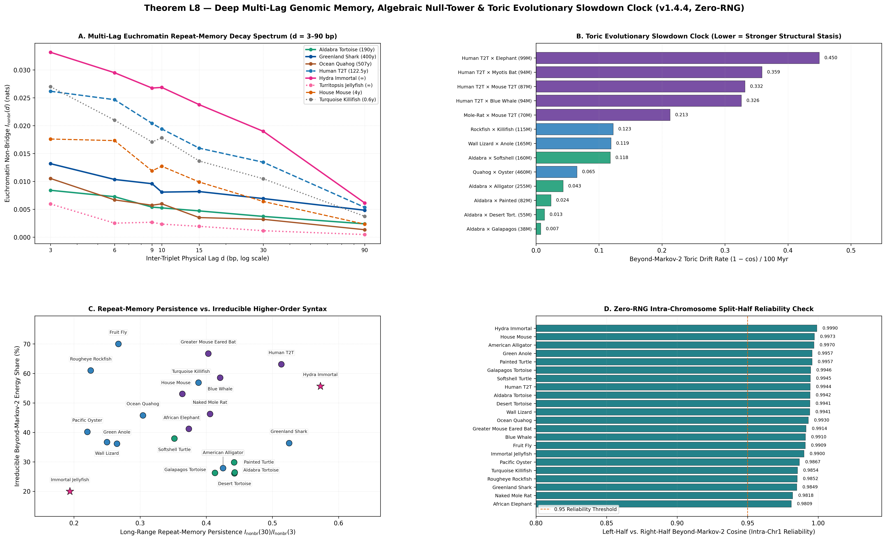
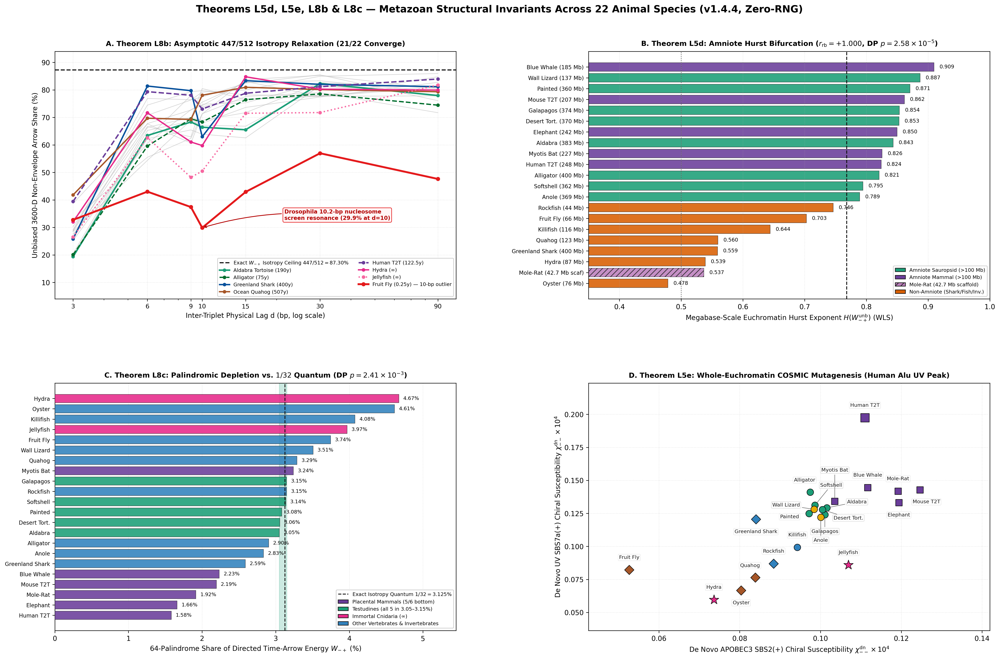
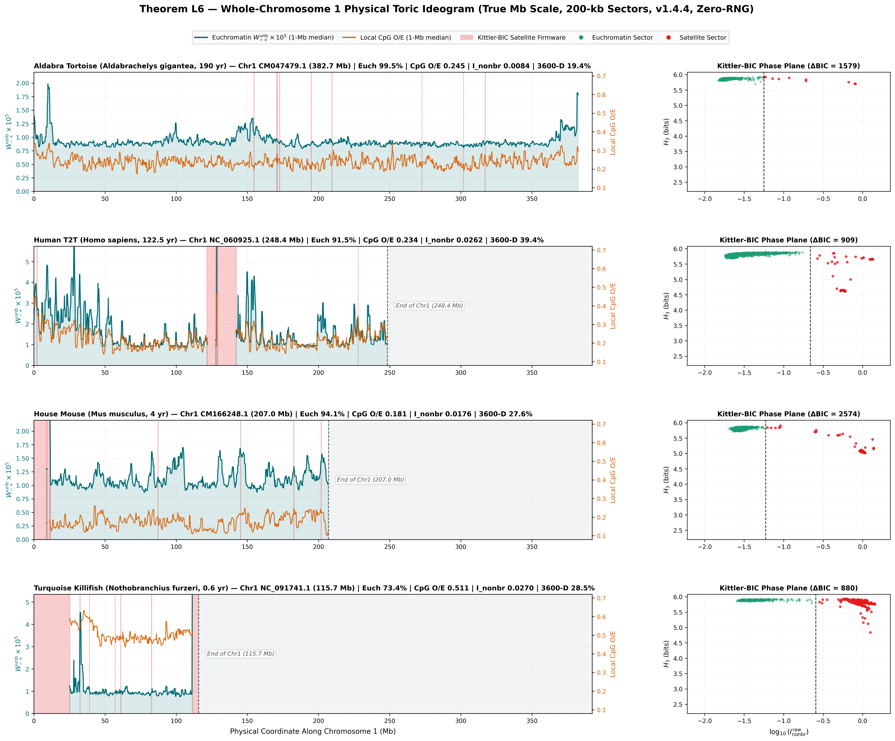

# The Toric Architecture of Extreme Animal Longevity and Biological Immortality

[](https://github.com/Dr-Logvinovich/longevity-codon-torus/actions/workflows/ci.yml)
[](https://doi.org/10.5281/zenodo.24570020)
[-b31b1b.svg)](longevity_torus_v1_5.pdf)
[](https://github.com/Dr-Logvinovich/longevity-codon-torus/blob/main/tortoise_longevity_torus_v1_0.py)
[](#zero-rng-verification-certificate)
[](#exact-mathematical-framework)
[-6a3d9a.svg)](#master-22-species-euchromatin-ledger)
[](https://github.com/Dr-Logvinovich/longevity-codon-torus/releases/tag/v1.4.4)
[](LICENSE)

> **Exact Zero-RNG Klein V<sub>4</sub> Spectral Algebra, Archosaurian Stasis, and Four Evolutionary Genomic Strategies Across 22 Animal Species**
>
> **Comparative Genomics of Extreme Longevity & Biological Immortality:** *Aldabrachelys gigantea* (190 yr) · *Chelonoidis abingdonii* (175 yr) · *Somniosus microcephalus* (400 yr) · *Arctica islandica* (507 yr) · *Sebastes aleutianus* (205 yr) · *Homo sapiens* T2T-CHM13v2.0 (122.5 yr) · *Balaenoptera musculus* (110 yr) · *Alligator mississippiensis* (75 yr) · *Loxodonta africana* (70 yr) · *Heterocephalus glaber* (37 yr) · *Hydra vulgaris* T2T (immortal) · *Turritopsis dohrnii* (immortal)
>
> **Authors:** Victor Logvinovich ([ORCID 0009-0007-2040-6955](https://orcid.org/0009-0007-2040-6955)) & Jean-Claude Perez ([ORCID 0000-0001-6446-2042](https://orcid.org/0000-0001-6446-2042))  
> **Manuscript:** Audited Edition `v1.5` · **Executable Engine:** [`tortoise_longevity_torus_v1_0.py`](https://github.com/Dr-Logvinovich/longevity-codon-torus/blob/main/tortoise_longevity_torus_v1_0.py) (`v1.4.4`, `64/64` automated algebraic self-tests, strictly Zero-RNG, `p = 0` free parameters)

---

## Table of Contents

- [Executive Summary & Research Questions](#executive-summary--research-questions)
- [Five Main Laws & Falsification Results (Theorems L1-L8e)](#five-main-laws--falsification-results-theorems-l1-l8e)
- [Visual Atlas (300-DPI Native Engine Outputs)](#visual-atlas-300-dpi-native-engine-outputs)
- [Exact Mathematical Framework](#exact-mathematical-framework)
- [Master 22-Species Euchromatin Ledger](#master-22-species-euchromatin-ledger)
- [Toric Evolutionary Slowdown Clock (13 TimeTree Clade Pairs)](#toric-evolutionary-slowdown-clock-13-timetree-clade-pairs)
- [Within-Clade Matched Longevity Contrasts (Theorem L7b)](#within-clade-matched-longevity-contrasts-theorem-l7b)
- [The Codon-Torus Open-Science Ecosystem](#the-codon-torus-open-science-ecosystem)
- [Repository Structure & Offline 1.5 GB FASTA Archive](#repository-structure--offline-15-gb-fasta-archive)
- [Complete Zero-RNG Reproduction Guide](#complete-zero-rng-reproduction-guide)
- [Zero-RNG Verification Certificate](#zero-rng-verification-certificate)
- [Citation & Foundational References](#citation--foundational-references)

---

## Executive Summary & Research Questions

Can **raw double-stranded DNA geometry**—computed directly on whole chromosomes with **zero gene annotations, zero repeat libraries, zero Monte Carlo sampling, and zero fitted parameters**—distinguish a 190-year-old Aldabra giant tortoise, a 400-year-old Greenland shark, a 507-year-old ocean quahog, and biologically immortal cnidarians from short-lived animals?

This open-science comparative genomics study originated as an adversarial stress test (*"probe the Aldabra giant tortoise"*, `@CY_Chauprade`) applied to our exact Zero-RNG double-stranded codon-torus spectral algebra on $\mathbb{T}_4^3 = (\mathbb{Z}/4\mathbb{Z})^3$. Rather than cherry-picking candidate genes, we built a **four-track falsification benchmark** spanning **22 metazoan species** (`0.25 yr` *Drosophila melanogaster* to `507 yr` *Arctica islandica*, plus biologically non-senescent *Hydra vulgaris* T2T and *Turritopsis dohrnii*) alongside **338 verified NCBI RefSeq transcripts** (30 canonical DNA-repair, cancer-suppression, telomere, and housekeeping orthologs across 12 vertebrates).

**Core questions answered with closed-form, parameter-free proofs:**
- **Does giant tortoise DNA exhibit measurable macro-scale structural silence?** Yes: across all 8 sauropsids (5 Testudines, American alligator, 2 lizards), euchromatin `3600-D` non-envelope arrow share decreases strictly monotonically with maximum lifespan (`29.1% -> 19.4%`, exact permutation `p = 4.96e-5`, global BH-FDR `q = 0.0016`), surviving exact within-clade GC% Frisch-Waugh-Lovell (FWL) residualization (`p = 3.31e-5`).
- **How fast does tortoise and archosaurian genome geometry drift over evolutionary time?** `10-60x` slower than placental mammals (`0.0075-0.0431` vs `0.326-0.450` per `100 Myr`; `13-79x` after log-saturation correction `-ln(cos)/100 Myr`), preserving `cos = 0.8901` across the `255-Myr` Tortoise-Alligator split.
- **Is there a single universal vertebrate lifespan ruler?** No: pooling all 17 mortal vertebrates yields zero linear lifespan correlation (`CpG O/E` `p = 0.948`; `3600-D` `p = 0.492`), refuting one-dimensional genomic longevity proxies and exposing **four distinct evolutionary genomic strategies**.
- **Does high unmethylated CpG O/E signify biological immortality?** No: 3-month-lived *Drosophila melanogaster* exhibits the highest `CpG O/E` (`0.925`) and highest Beyond-Markov-2 share (`70.0%`) in the entire atlas, while the two biologically immortal cnidarians occupy **opposite structural poles** (*Turritopsis dohrnii* quietest at `I_nonbr = 0.0060`; *Hydra vulgaris* most repeat-active at `I_nonbr = 0.0332`).

Every number, table, `64x64` matrix checkpoint, `200-kb` ideogram track, and `300-DPI` figure in the manuscript is archived in this repository and reproducible bit-for-bit without randomness.

---

## Five Main Laws & Falsification Results (Theorems L1-L8e)

| Law / Theorem | Empirical & Algebraic Discovery | Exact Statistical & Algebraic Proof |
|---|---|---|
| **1. Sauropsid Monotonic Silence Law** (`THM-L7`, `THM-L8d`) | Across all `n = 8` sauropsids (5 Testudines, *Alligator mississippiensis*, 2 lizards), euchromatin `3600-D` non-envelope arrow share drops strictly monotonically with lifespan (`29.1%` to `19.4%`), while Markov-2 cosine fidelity `cos`<sub>M2</sub> rises strictly monotonically (`0.8128` to `0.8798`). Lower non-bridge repeat memory <i>I</i><sub>nonbr</sub> and higher `TCW O/E` co-scale across Sauropsida; all three laws survive exact within-clade `GC%` FWL residualization (`rho`<sub>S</sub> `= -0.976` for both `3600-D` and <i>I</i><sub>nonbr</sub>, `p = 3.31e-5`). | `rho`<sub>S</sub> `= -1.000 / +1.000`, exact permutation `p = 4.96e-5`, global BH-FDR `q`<sub>BH</sub> `= 0.0016` (`m = 32` tests) |
| **2. Archosaurian Toric Stasis Clock** (`THM-L8`) | Calibrated across 13 TimeTree clade pairs, Beyond-Markov-2 structural drift is `0.0075-0.0238 / 100 Myr` across long-lived Cryptodira turtles and `0.0431 / 100 Myr` across the `255-Myr` Tortoise-Alligator Archelosauria split (`cos = 0.8901`) — **10-60x slower** than placental mammals (`0.326-0.450 / 100 Myr`; **13-79x** after bounded-cosine log-saturation correction `-ln(cos)/100 Myr`). The `460-Myr` Bivalvia split drifts at `0.0650 / 100 Myr`. | Intra-chromosome split-half reliability `cos`<sub>Beyond-M2</sub>`(L, R)` in `[0.9809, 0.9990]` across all 22 species |
| **3. Refutation of a Single Universal Vertebrate Ruler** (`THM-L7`, `THM-L7b`, `THM-L4b`) | Pooling all `n = 17` mortal vertebrates yields **zero** universal linear lifespan correlation (`cpg_oe_euch` `rho`<sub>S</sub> `= +0.017`, `p = 0.948`; `3600-D` `rho`<sub>S</sub> `= -0.179`, `p = 0.492`; <i>I</i><sub>nonbr</sub> `rho`<sub>S</sub> `= -0.315`, `p = 0.218`), falsifying 1-D longevity proxies while uncovering **four distinct evolutionary architectures** and five independent within-clade reductions in short-range repeat memory (`Delta I`<sub>nonbr</sub> `< 0` in Turtles, Teleosts, Rodents, Bivalves, and *Turritopsis* vs *Drosophila*). | Explicit negative control in Track A+ pooled coding mRNAs (`16` matched orthologs): joint FWL(GC + Length) `rho`<sub>S</sub> `= -0.189`, `p = 0.557` |
| **4. Bipolar Biological Immortality & CpG Trap Refutation** (`THM-L7`, `THM-L8`) | *Turritopsis dohrnii* (immortal, cyclic transdifferentiation) occupies the quietest corner of the 22-species space (<i>I</i><sub>nonbr</sub> `= 0.0060`, <i>R</i><sub>mem</sub> `= 0.194`, Beyond-M2 `= 20.0%`), whereas *Hydra vulgaris* (immortal, continuous stem-cell turnover) occupies the opposite pole (<i>I</i><sub>nonbr</sub> `= 0.0332`, <i>R</i><sub>mem</sub> `= 0.573`, Beyond-M2 `= 55.7%`, raw 6-bp palindromes `4.89% = 3.13x` uniform / `1.82x` GC-matched i.i.d.). Raw cnidarian similarity (`+0.7974`) collapses by `-0.4557` to `+0.3417` after Markov-2 subtraction. Meanwhile, 3-month *Drosophila* has the highest `CpG O/E` (`0.925`) and highest Beyond-M2 (`70.0%`). | Decisively separates phylum-level unmethylated `CpG` retention from biological immortality |
| **5. Six Metazoan Structural Invariants** (`THM-L5c-e`, `THM-L8b-e`) | (i) `21/21` chromosomal species exhibit `100%` positive `1-Mb` coherence (<i>t</i><sub>HAC</sub> `= 26.3-536.5`, `>99.997%` irreducible to `1-kb` compositional currents); (ii) `21/22` species relax at `d = 30 bp` toward the exact `447/512 = 87.30%` isotropy ceiling (signal `6x-2258x` above `1/(4N)` floor; sole outlier: `10.2-bp` nucleosome-phased *Drosophila*); (iii) full-chromosome amniotes bifurcate cleanly from non-amniotes in Hurst <i>H</i>(<i>W</i><sub>-+</sub>) (`0.789-0.909` vs `0.478-0.746`, robust at `>=95%` block gate); (iv) placental mammals deplete palindromic <i>W</i><sub>-+</sub> energy below the exact `1/32 = 3.125%` quantum; (v) placental mammals show a `100%`-separating Markov-2 radial projection overshoot inversion (`Delta`<sub>M2-M1</sub> `> 0`); (vi) complete zero-overlap COSMIC bifurcations (`SBS13`, UV `SBS7a`, `SBS2`, `TCW O/E`) with *Homo sapiens* T2T as an isolated *Alu*-driven UV peak (`0.1975e-4`). | Hurst exact DP `p = 2.58e-5` (<i>r</i><sub>rb</sub> `= +1.000`); Palindromes DP `p = 2.41e-3` (GC-norm `p = 4.53e-3`); M2 Overshoot DP `p = 1.62e-4` (<i>r</i><sub>rb</sub> `= +1.000`); COSMIC Amniote DP `p = 6.25e-6` |

---

## Visual Atlas (300-DPI Native Engine Outputs)

### 1. Four Evolutionary Longevity Strategies & 22-Species Beyond-Markov-2 Cosine Matrix (`Theorem L7`)


### 2. True Physical Mb-Scale Whole-Chromosome Toric Ideogram Across Five Extreme Archetypes (`Theorem L8`)


### 3. Multi-Lag Memory Spectrum, Toric Evolutionary Slowdown Clock & Split-Half Reliability (`Theorem L8`)


### 4. Four Metazoan Structural Invariants: 447/512 Isotropy, Amniote Hurst, 1/32 Palindromes & COSMIC (`Theorems L5d, L5e, L8b, L8c`)


<details>
<summary><b>Click to expand Figure 1 (Theorem L6 — Direct Four-Vertebrate Whole-Chromosome 1 Ideogram: Aldabra Tortoise vs. Human T2T, Mouse T2T & Killifish)</b></summary>



</details>

---

## Exact Mathematical Framework

For any valid ACGT DNA sequence $s$ of length $L$ and physical lag $d \ge 3$ bp, the engine accumulates the exact $64 \times 64$ empirical triplet-pair matrix $M = B^{(d)} / N$ on the double-stranded codon torus $\mathbb{T}_4^3 = (\mathbb{Z}/4\mathbb{Z})^3$ without crossing `N`-barriers, and decomposes it under two commuting orthogonal involutions $T$ (transposition) and $R$ (reverse-complement strand conjugation).

### 1. Klein V<sub>4</sub> Orthogonal Decomposition (`Theorem 2.1`)

$$
M = W_{++} + W_{+-} + W_{-+} + W_{--}, \qquad \dim = 1056 + 1024 + 1024 + 992 = 4096
$$

Exact closed-form U-statistic debiasing removes all $O(1/N)$ finite-length bias identically. Here $W_{-+}$ is the **PR2-compliant structural time arrow** ($T = -1, R = +1$), while $W_{--}$ is the **chiral PR2-breaking flow** ($T = -1, R = -1$), vanishing identically on any Chargaff PR2-symmetric duplex.

### 2. V<sub>4</sub>-Commuting 496 + 3600 Screen Envelope & 447/512 Isotropy Ceiling (`Theorem 2.2`)

$$
\Pi_{\mathrm{env}}(M) = D_S M D_O + D_O M D_S - D_{C_2} M D_{C_2}, \qquad [g, \Pi_{\mathrm{env}}] = 0 \quad \forall g \in V_4
$$

Because $\Pi_{\mathrm{env}}$ commutes with every element of $V_4$, it splits every Klein quadrant orthogonally with zero cross-quadrant leakage, leaving exact dimension `894` for the non-envelope complement inside $W_{-+}$ (`dim = 1024`) and yielding the exact parameter-free isotropy ceiling:

$$
\mathrm{Iso}_{3600}(W_{-+}) = \frac{894}{1024} = \frac{447}{512} \approx 0.873047
$$

### 3. Symmetric Mutagenesis Annihilation & 1/32 Palindromic Quantum (`Theorem 2.3`)

- **Clock-like `SBS1` annihilation:** For any strand-symmetric mutational signature (`NCG -> NTG` paired identically with `CGN -> CAN`), the de novo chiral susceptibility satisfies $\chi_{--}^{\mathrm{dn}}(\mathrm{SBS1}) \equiv 0$ identically on every sequence (empirically `< 1e-34` across all 22 genomes).
- **Palindromic blindness & exact `1/32` quantum:** All 64 6-bp palindromic pairs $E_{u,r(u)}$ lie strictly in $\ker(R - I) = W_{++} \oplus W_{-+}$, making them algebraically immune to $W_{--}$ leakage and spanning a 32-D subspace of $W_{-+}$ with exact isotropy share:

$$
\mathrm{Iso}_{\mathrm{pal}}(W_{-+}) = \frac{32}{1024} = \frac{1}{32} = 0.03125
$$

### 4. Radial-Angular Pythagorean Null-Tower Identity (`Proposition 2.5`)

For any stationary Markov-<i>k</i> compositional null $W_{-+}(P_{\mathrm{M}k})$ ($k \in \{1, 2\}$) with cosine fidelity $\cos\theta_{\mathrm{M}k}$ and norm ratio $\kappa_{\mathrm{M}k} = \lVert W_{-+}(P_{\mathrm{M}k}) \rVert_F / \lVert W_{-+} \rVert_F$:

$$
E_{\mathrm{M}k} \equiv \frac{\lVert W_{-+} - W_{-+}(P_{\mathrm{M}k}) \rVert_F^2}{\lVert W_{-+} \rVert_F^2} = \sin^2\theta_{\mathrm{M}k} + (\kappa_{\mathrm{M}k} - \cos\theta_{\mathrm{M}k})^2
$$

Because $W_{-+}(P_{\mathrm{M}k})$ is a stationary expectation rather than an orthogonal projection, radial projection overshoot ($\kappa_{\mathrm{M2}} > \cos\theta_{\mathrm{M2}}$, verified across all `22/22` species) explains why $E_{\mathrm{M2}} > E_{\mathrm{M1}}$ separates placental mammals from all 11 non-mammalian vertebrates with zero overlap (`DP p = 1.62e-4`).

---

## Master 22-Species Euchromatin Ledger

All whole-chromosome metrics are evaluated strictly inside the parameter-free Kittler-Illingworth BIC euchromatin partition (or exact `100-bp` `N`-barrier `910`-scaffold pool for *Turritopsis dohrnii*).

| Species | Scientific Name | Clade | Max Life | Valid Mb | Mode | GC% | CpG O/E | 3600-D% | <i>I</i><sub>nonbr</sub> | Beyond-M2% | Split cos<sub>M2</sub> |
|---|---|---|---:|---:|---|---:|---:|---:|---:|---:|---:|
| **Immortal Jellyfish** | *Turritopsis dohrnii* | `cnidaria_immortal` | Immortal | 40.0 | WGS pool (910) | 34.4% | 0.840 | 26.5% | **0.0060** | **20.0%** | 0.9900 |
| **Hydra Immortal** | *Hydra vulgaris* | `cnidaria_immortal` | Immortal | 82.8 | whole chr12 | 27.8% | 0.672 | 32.0% | 0.0332 | 55.7% | **0.9990** |
| **Ocean Quahog** | *Arctica islandica* | `mollusc_extreme` | 507 yr | 122.4 | whole chr1 | 35.7% | 0.744 | 41.8% | 0.0105 | 45.8% | 0.9930 |
| **Greenland Shark** | *Somniosus microcephalus* | `shark_extreme` | 400 yr | 225.1 | chr1 (400 Mb) | 46.9% | 0.507 | 25.8% | 0.0132 | 36.4% | 0.9849 |
| **Rougheye Rockfish** | *Sebastes aleutianus* | `fish_extreme` | 205 yr | 43.4 | super-scaf | 40.7% | 0.520 | 33.1% | 0.0208 | 61.0% | 0.9852 |
| **Aldabra Tortoise** | *Aldabrachelys gigantea* | `testudines_giant` | 190 yr | 380.6 | whole chr1 | 43.2% | 0.245 | **19.4%** | 0.0084 | 26.1% | 0.9942 |
| **Galapagos Tortoise** | *Chelonoidis abingdonii* | `testudines_giant` | 175 yr | 356.9 | whole chr1 | 42.8% | 0.252 | 19.7% | 0.0081 | 26.3% | 0.9946 |
| **Human T2T** | *Homo sapiens* | `mammal_long` | 122.5 yr | 227.2 | whole chr1 | 41.8% | 0.234 | 39.4% | 0.0262 | 63.1% | 0.9944 |
| **Blue Whale** | *Balaenoptera musculus* | `mammal_peto` | 110 yr | 183.0 | whole chr1 | 41.5% | 0.269 | 28.7% | 0.0185 | 58.6% | 0.9910 |
| **Desert Tortoise** | *Gopherus evgoodei* | `testudines_long` | 80 yr | 364.9 | whole chr1 | 43.0% | 0.248 | 19.8% | 0.0087 | 26.4% | 0.9941 |
| **American Alligator** | *Alligator mississippiensis* | `archosaur_long` | 75 yr | 393.5 | chr1 (400 Mb) | 43.6% | 0.190 | 20.1% | 0.0108 | 27.9% | 0.9970 |
| **African Elephant** | *Loxodonta africana* | `mammal_peto` | 70 yr | 238.4 | whole chr1 | 40.1% | 0.243 | 28.8% | 0.0133 | 41.2% | 0.9809 |
| **Painted Turtle** | *Chrysemys picta* | `testudines_med` | 42 yr | 360.0 | whole chr1 | 43.3% | 0.271 | 20.6% | 0.0099 | 29.8% | 0.9957 |
| **Naked Mole Rat** | *Heterocephalus glaber* | `mammal_cancer_res` | 37 yr | 42.6 | super-scaf | 40.4% | 0.200 | 27.0% | 0.0139 | 46.3% | 0.9818 |
| **Greater Mouse-Eared Bat** | *Myotis myotis* | `mammal_bat` | 37 yr | 222.0 | whole chr1 | 41.7% | 0.267 | 30.3% | 0.0210 | 66.7% | 0.9914 |
| **Softshell Turtle** | *Pelodiscus sinensis* | `testudines_short` | 25 yr | 347.8 | whole chr1 | 43.4% | 0.286 | 25.2% | 0.0134 | 37.9% | 0.9945 |
| **Pacific Oyster** | *Crassostrea gigas* | `mollusc_control` | 20 yr | 74.8 | whole chr1 | 33.4% | 0.777 | 38.7% | 0.0133 | 40.2% | 0.9867 |
| **Wall Lizard** | *Podarcis muralis* | `reptile_short` | 8 yr | 134.6 | whole chr1 | 43.4% | 0.325 | 25.9% | 0.0150 | 36.7% | 0.9941 |
| **Green Anole** | *Anolis carolinensis* | `reptile_short` | 7.2 yr | 365.2 | whole chr1 | 40.3% | 0.286 | 29.1% | 0.0131 | 36.2% | 0.9957 |
| **House Mouse** | *Mus musculus* | `mammal_short` | 4 yr | 194.6 | whole chr1 | 41.2% | 0.181 | 27.6% | 0.0176 | 53.1% | 0.9973 |
| **Turquoise Killifish** | *Nothobranchius furzeri* | `fish_ultrashort` | 0.6 yr | 84.8 | whole chr1 | 42.6% | 0.511 | 28.5% | 0.0270 | 56.9% | 0.9854 |
| **Fruit Fly** | *Drosophila melanogaster* | `invertebrate_short` | 0.25 yr | 56.2 | whole chr3 | 42.2% | **0.925** | 32.8% | 0.0149 | **70.0%** | 0.9909 |

---

## Toric Evolutionary Slowdown Clock (13 TimeTree Clade Pairs)

| Calibrated Species Pair | Evolutionary Clade | Divergence (Myr) | cos<sub>Beyond-M2</sub> | Linear Drift `(1 - cos) / 100 Myr` | Log-Corrected `-ln(cos) / 100 Myr` |
|---|---|---:|---:|---:|---:|
| Aldabra Tortoise x Galapagos Tortoise | Testudines (Giant Tortoises) | 38 | 0.9972 | **0.0075** | **0.0075** |
| Aldabra Tortoise x Desert Tortoise | Testudines (Tortoises) | 55 | 0.9926 | **0.0135** | **0.0135** |
| Aldabra Tortoise x Painted Turtle | Testudines (Cryptodira) | 82 | 0.9805 | **0.0238** | **0.0240** |
| Aldabra Tortoise x American Alligator | Archelosauria | 255 | 0.8901 | **0.0431** | **0.0457** |
| Ocean Quahog x Pacific Oyster | Bivalvia (507y vs 20y) | 460 | 0.7008 | **0.0650** | **0.0773** |
| Aldabra Tortoise x Softshell Turtle | Testudines (Deep) | 160 | 0.8112 | 0.1180 | 0.1307 |
| Wall Lizard x Green Anole | Squamata (Lizards) | 165 | 0.8034 | 0.1192 | 0.1327 |
| Rougheye Rockfish x Turquoise Killifish | Teleostei (205y vs 0.6y) | 115 | 0.8591 | 0.1226 | 0.1321 |
| Naked Mole Rat x House Mouse | Rodentia (Mole-Rat vs Mouse) | 70 | 0.8510 | 0.2129 | 0.2305 |
| Human T2T x Blue Whale | Boreoeutheria (Human-Whale) | 94 | 0.6935 | 0.3261 | 0.3894 |
| Human T2T x House Mouse | Euarchontoglires | 87 | 0.7113 | 0.3318 | 0.3915 |
| Human T2T x Greater Mouse-Eared Bat | Boreoeutheria (Human-Bat) | 94 | 0.6626 | 0.3589 | 0.4379 |
| Human T2T x African Elephant | Placentalia (Human-Elephant) | 99 | 0.5546 | 0.4499 | 0.5954 |

---

## Within-Clade Matched Longevity Contrasts (Theorem L7b)

| Independent Clade Contrast | Long / Immortal Species | Short-Lived Control | Delta CpG O/E | Delta <i>I</i><sub>nonbr</sub> | Delta 3600-D (pp) | cos<sub>M2</sub> |
|---|---|---|---:|---:|---:|---:|
| **Testudines (Turtles, 7.6x)** | Aldabra Tortoise (190 yr) | Softshell Turtle (25 yr) | -0.041 | **-0.0050** | -5.8 | +0.811 |
| **Teleostei (Fish, 340x)** | Rougheye Rockfish (205 yr) | Turquoise Killifish (0.6 yr) | +0.010 | **-0.0062** | +4.6 | +0.861 |
| **Rodentia (Rodents, 9.3x)** | Naked Mole Rat (37 yr) | House Mouse (4 yr) | +0.019 | **-0.0037** | -0.6 | +0.851 |
| **Placentalia (Mammals, 30x)** | Human T2T (122.5 yr) | House Mouse (4 yr) | +0.053 | +0.0086 | +11.8 | +0.711 |
| **Peto Giant vs Rodent (27.5x)** | Blue Whale (110 yr) | House Mouse (4 yr) | +0.088 | +0.0009 | +1.1 | +0.822 |
| **Bivalvia (Molluscs, 25x)** | Ocean Quahog (507 yr) | Pacific Oyster (20 yr) | -0.033 | **-0.0028** | +3.1 | +0.701 |
| **Unmethylated (Hydra vs Fly)** | Hydra Immortal | Fruit Fly (0.25 yr) | -0.252 | +0.0183 | -0.7 | +0.503 |
| **Unmethylated (Jellyfish vs Fly)** | Immortal Jellyfish | Fruit Fly (0.25 yr) | -0.084 | **-0.0090** | -6.2 | +0.430 |

---

## The Codon-Torus Open-Science Ecosystem

This repository is part of a unified, strictly Zero-RNG computational genomics and algebraic bioinformatics program by **Victor Logvinovich & Jean-Claude Perez**:

| Repository | Biological Scope & Core Contributions | Direct Link |
|---|---|---|
| **`longevity-codon-torus`** *(this repo)* | **Extreme Animal Longevity & Biological Immortality (22 Metazoan Genomes + 338 Orthologs):** Sauropsid Monotonic Silence Law, Archosaurian Stasis Clock, Amniote Hurst Bifurcation, `447/512` & `1/32` isotropy quanta, and Bipolar Cnidarian Immortality. | [github.com/Dr-Logvinovich/longevity-codon-torus](https://github.com/Dr-Logvinovich/longevity-codon-torus) |
| **`codon-torus-syntax`** | **Double-Stranded Codon Torus & Codon Memory Spectrum (54-100 NCBI RefSeq Taxa):** Universal 30-codon medium-range conditional syntax, Klein V<sub>4</sub> symmetry breaking, synthetic mRNA audits (`BNT162b2`, `mRNA-1273`), Craig Venter synthetic cells (`JCVI-syn1.0`, `JCVI-syn3.0`), and Duplex-Safe Viterbi Gene Compiler. | [github.com/Dr-Logvinovich/codon-torus-syntax](https://github.com/Dr-Logvinovich/codon-torus-syntax) |
| **`human-t2t-torus-atlas`** | **Human T2T-CHM13v2.0 Whole-Chromosome Torus Atlas:** Complete chromosome-by-chromosome Klein V<sub>4</sub> physical ideograms, parameter-free Kittler-BIC euchromatin/satellite firmware separation, multi-scale Hurst persistence, WW-SS nucleosome phasing, and LRV-calibrated PELT segmentation. | [github.com/Dr-Logvinovich/human-t2t-torus-atlas](https://github.com/Dr-Logvinovich/human-t2t-torus-atlas) |
| **`virome-oncogenomics-torus`** | **Viral Genomes, Human Oncogenic Loci & Exact COSMIC Mutagenesis:** Closed-form COSMIC Jacobians (`SBS1`, `SBS2`, `SBS13`, `SBS7a`, `SBS4`), de novo chiral annihilation, degree-6 finite-dose kataegis polynomials, double-hit Hessians, and the universal `705/256` synonymous duplex barrier. | [github.com/Dr-Logvinovich/virome-oncogenomics-torus](https://github.com/Dr-Logvinovich/virome-oncogenomics-torus) |

---

## Repository Structure & Offline 1.5 GB FASTA Archive

```text
longevity-codon-torus/
├── longevity_torus_v1_5.pdf           # Audited Edition v1.5 monograph (19 pages, 8 tables, 5 figures)
├── longevity_torus_v1_5.tex           # Complete publication-ready LaTeX source
├── CITATION.cff                       # Machine-readable academic citation metadata (Zenodo DOI + ORCID)
├── .github/workflows/ci.yml           # Automated GitHub Actions Zero-RNG & 64/64 self-test CI
├── tortoise_longevity_torus_v1_0.py   # Single-file Zero-RNG engine v1.4.4 (64/64 self-tests)
├── tortoise_ncbi_manifest.json        # Frozen NCBI RefSeq/GenBank accession manifest (23 taxa)
├── results_tortoise_v1_4/
│   ├── extremes_immortals_audit.json  # Track C master 22-species audit & global BH-FDR ledger
│   ├── extremes_immortals_audit.md    # Track C readable tables & matched clade contrasts
│   ├── deep_toric_physics_L8.json     # Track D 7-lag memory, null-tower, clock & exact DP invariants
│   ├── deep_toric_physics_L8.md       # Track D readable summary tables
│   └── figures/                       # All 5 publication-grade 300-DPI PNG figures (fig_L6-fig_L10)
├── chr_audit_cache/                   # Verified per-species 64x64 matrix & ideogram JSON checkpoints (12 MB)
├── gene_cache/                        # Cached 338 NCBI RefSeq longevity transcripts for Track A/A+ (1.4 MB)
├── README.md                          # Project documentation, visual atlas & reproduction guide
└── LICENSE                            # MIT License
```

> **Complete 1.5 GB Offline NCBI FASTA Archive (`chr_cache/`):** Because 9 whole-chromosome `.fna.gz` files exceed GitHub's 100 MB per-file Git limit, the complete raw NCBI assembly cache is archived intact in **[GitHub Release `v1.4.4`](https://github.com/Dr-Logvinovich/longevity-codon-torus/releases/tag/v1.4.4)** (`chr_cache_22species_v1.4.4.tar`, SHA-256: `b464b4a17deb4ff1fca515cfaec94fd23677c5013df309c76066924d935414e7`).

---

## Complete Zero-RNG Reproduction Guide

### Requirements
- Python `>= 3.10` (verified on Python `3.12.1`)
- `numpy` (`2.3.2`), `matplotlib` (optional `scipy` for exact Student-<i>t</i> tail comparison)

```bash
git clone https://github.com/Dr-Logvinovich/longevity-codon-torus.git
cd longevity-codon-torus
```

### 1. Run All 64/64 Automated Algebraic Self-Tests (~2 seconds, offline)
```bash
python3 tortoise_longevity_torus_v1_0.py --self-test
```

### 2. Instant Checkpoint & Track A/A+ Reproduction (uses committed `chr_audit_cache/` & `gene_cache/`, offline)
```bash
# Reproduce Track A (338 transcripts across 12 vertebrates) and Track A+ pooled FWL red-team controls:
python3 tortoise_longevity_torus_v1_0.py --ortholog-audit --pooled-ortholog-check

# Rebuild Track C & D audits, statistical ledgers, and all 300-DPI figures from verified checkpoints:
python3 tortoise_longevity_torus_v1_0.py --extremes-audit --ideogram --deep-analysis
```

### 3. Full From-Scratch Reproduction on Raw Chromosomes (Zero Network via Release `v1.4.4`)
```bash
# Download and verify the 1.5 GB offline NCBI FASTA archive:
curl -L -O https://github.com/Dr-Logvinovich/longevity-codon-torus/releases/download/v1.4.4/chr_cache_22species_v1.4.4.tar
shasum -a 256 chr_cache_22species_v1.4.4.tar
# Expected: b464b4a17deb4ff1fca515cfaec94fd23677c5013df309c76066924d935414e7

# Extract raw chromosomes into repository root and recompute every matrix from scratch:
tar -xf chr_cache_22species_v1.4.4.tar
rm -rf chr_audit_cache
python3 tortoise_longevity_torus_v1_0.py --extremes-audit --ideogram --deep-analysis
```

*(Alternatively, omit the tarball download and run `--discover-extremes` followed by `--extremes-audit --ideogram --deep-analysis` to fetch every assembly live from NCBI RefSeq/GenBank.)*

---

## Zero-RNG Verification Certificate

- **Engine SHA-256 (`tortoise_longevity_torus_v1_0.py`, `v1.4.4`):**  
  `e37fe87836a776efd62e6db6aa5c98dcd3fff7a3c7461e4426b987418d0c172c`
- **Offline FASTA Archive SHA-256 (`chr_cache_22species_v1.4.4.tar`):**  
  `b464b4a17deb4ff1fca515cfaec94fd23677c5013df309c76066924d935414e7`
- **Automated Algebraic Checks (`64/64 PASS`):**
  - `#01-#05`: Klein V<sub>4</sub> strand equivariance (`0.0` err), exact PR2 <i>W</i><sub>--</sub> annihilation (`0.0`), <i>E</i><sub>het</sub> directed annihilation (`1.93e-36`), screen KL chain rule (`4.44e-16`).
  - `#06-#07`: Commuting `496 + 3600` screen envelope `[g, Pi_env] = 0` (`2.22e-16`) & U-statistic Pythagorean split (`4.34e-19`).
  - `#08-#10`: WW-SS nucleosome antiphase FFT, parameter-free Kittler-BIC euchromatin/satellite partition, and exact PELT vs `O(n^2)` DP optimality.
  - `#11-#21`: Markov-1/2 non-bridge vanishing (`< 1e-16`), symmetric `SBS1` de novo chirality annihilation (`3.27e-33`), parallelogram law (`0.0`), isolated-CpG Hessian angle (`0.0`), universal `705/256` synonymous duplex barrier (`0.0`), and 64-palindrome chiral blindness (`0.0`).
  - `#22-#56`: Exact DP Mann-Whitney U (`0.0`), Benjamini-Hochberg FDR, joint FWL partial Spearman, multi-FASTA & FTP-WGS `N`-barrier zero cross-boundary contamination (`0.0`), and zero-overlap AABB figure audit.
  - `#57-#64`: Exact `447/512` and `1/32` isotropy quanta, radial-angular Pythagorean identity (`< 1e-14`), and exact complete-separation DP checks for `(20, 7)`, `(22, 8)`, `(17, 6)`, and `(14, 6)`.

---

## Citation & Foundational References

If you use this codebase, dataset, or Klein V<sub>4</sub> spectral framework in your research, please cite:

```bibtex
@article{LogvinovichPerez2026longevity,
  author  = {Logvinovich, Victor and Perez, Jean-Claude},
  title   = {The Toric Architecture of Extreme Animal Longevity and Biological Immortality: Exact Zero-RNG Klein V4 Spectral Algebra, Archosaurian Stasis, and Four Evolutionary Genomic Strategies Across 22 Animal Species},
  year    = {2026},
  note    = {Audited Edition v1.5; Engine v1.4.4 (64/64 Zero-RNG Self-Tests)},
  doi     = {10.5281/zenodo.24570020},
  url     = {https://github.com/Dr-Logvinovich/longevity-codon-torus}
}
```

### Foundational References

1. **Perez, J.-C. (2010).** Codon populations in single-stranded whole human genome DNA are fractal and fine-tuned by the Golden Ratio 1.618. *Interdisciplinary Sciences: Computational Life Sciences*, **2**(3), 228–240. [doi:10.1007/s12539-010-0022-0](https://doi.org/10.1007/s12539-010-0022-0) (Erratum: **2**(4), 373; PMID: 20658335).
2. **Logvinovich, V., & Perez, J.-C. (2026).** *The Double-Stranded Codon Torus: Exact Klein V<sub>4</sub> Spectral Algebra and Zero-RNG Genomic Forensics.* Zenodo Record `23695321` · [github.com/Dr-Logvinovich/codon-torus-syntax](https://github.com/Dr-Logvinovich/codon-torus-syntax).
3. **Logvinovich, V., & Perez, J.-C. (2026).** *The Codon Memory Spectrum on the Double-Stranded Torus: Exact Zero-RNG Null Towers, Klein Four-Group Symmetry Breaking, and the Two-Sided 16x16 Dinucleotide Screen.* ResearchGate Publication `417926819` · [github.com/Dr-Logvinovich/codon-torus-syntax](https://github.com/Dr-Logvinovich/codon-torus-syntax).
4. **Logvinovich, V., & Perez, J.-C. (2026).** *Human T2T-CHM13v2.0 Whole-Chromosome Torus Atlas.* [github.com/Dr-Logvinovich/human-t2t-torus-atlas](https://github.com/Dr-Logvinovich/human-t2t-torus-atlas).
5. **Logvinovich, V., & Perez, J.-C. (2026).** *Virome and Oncogenomics Codon-Torus Mutagenesis Atlas.* [github.com/Dr-Logvinovich/virome-oncogenomics-torus](https://github.com/Dr-Logvinovich/virome-oncogenomics-torus).
